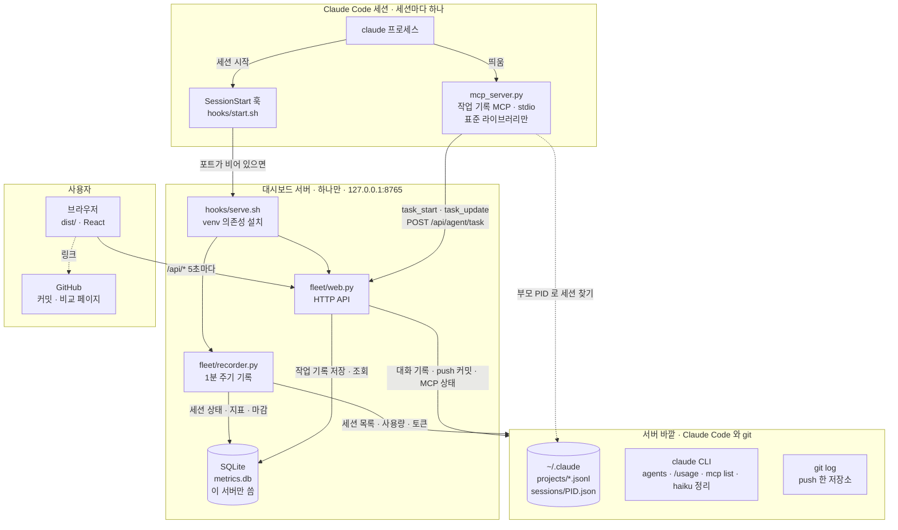

# hudson-fleet

내 PC에서 돌고 있는 Claude Code 세션들을 한 화면에서 보는 로컬 대시보드입니다.

살아 있는 세션의 상태, 서브에이전트, 작업 내용, 연결된 MCP 서버를 봅니다.

## 아키텍처

세션마다 뜨는 MCP 서버는 작업 기록을 대시보드 서버의 API 로 보냅니다. DB 는 대시보드 서버 하나만 씁니다 (나중에 서버를 따로 두고 함께 쓸 수 있게).



## 설치 (Claude Code 플러그인)

```
/plugin install hudson-fleet --marketplace hava12/hudson-fleet
```

Claude Code 2.1.275 이전이면 두 단계로 설치합니다.

```
/plugin marketplace add hava12/hudson-fleet
/plugin install hudson-fleet@hudson-fleet
```

설치하면 두 가지가 함께 들어옵니다.

- **SessionStart 훅**: 세션이 시작될 때 대시보드 서버(8765)가 없으면 백그라운드로 띄웁니다. 세션이 다 끝나도 서버는 남습니다. 플러그인을 업데이트했다면 떠 있는 서버를 한 번 꺼야 새 코드로 뜹니다.
- **MCP 서버 `fleet`**: 에이전트가 작업을 시작·완료·중단·반려할 때 직접 기록합니다 (아래 "작업 기록"). 기록은 대시보드 서버로 보냅니다.

브라우저에서 http://127.0.0.1:8765 를 엽니다.

## 직접 실행

```sh
hooks/serve.sh      # → http://127.0.0.1:8765 (requirements.txt 가 비어 있으면 python3 server.py 와 같다)
```

- Python 3.9 이상. MCP 서버는 표준 라이브러리만, 웹 서버는 `requirements.txt` 의 의존성을 더 쓸 수 있습니다 (아래 "의존성").
- `claude` CLI가 PATH에 있어야 합니다.
- 화면은 `web/` 의 React(Vite) 앱이고, 서버는 빌드 결과 `dist/` 를 내보냅니다. 그래프 라이브러리도 함께 묶여 인터넷 연결 없이 뜹니다.

## 화면 개발 (web/)

```sh
cd web && npm install
npm run dev     # → http://localhost:5173 (API 는 떠 있는 8765 서버로 넘깁니다)
npm run build   # → ../dist
```

- `dist/` 는 커밋합니다. 플러그인 설치가 저장소를 그대로 받기 때문입니다.
- `web/` 이 바뀐 커밋이 main 에 들어오면 GitHub Actions(`.github/workflows/web.yml`)가 빌드해 `dist/` 를 커밋하고 플러그인 패치 버전을 1 올립니다. 그래서 `web/` 만 고칠 때는 버전을 손으로 올리지 않습니다.

| 파일 | 하는 일 |
|---|---|
| `src/main.jsx` | 상단 메뉴·사용량·알림, 페이지 전환(#home 등), 오른쪽 패널 틀, 함께 쓰는 상태(`App` 컨텍스트) |
| `src/Home.jsx` | 현황: 숫자 타일, 상태별 노드(그래프 + `SessionCard`), 남은 작업, 작업 현황 리스트 |
| `src/Pages.jsx` | 세션 기록 · Push 기록 · 설정 |
| `src/Mcp.jsx` | MCP 서버 그래프 |
| `src/SidePanel.jsx` | 오른쪽 패널: 프로젝트 · 세션 · MCP 서버 · 끝난 세션 |
| `src/TaskList.jsx` | 작업 목록 `TaskList` → `TaskRow` (key=작업 id, 펼침은 줄마다 `useState`). 줄 앞 기호(○ ✓ ✕ ‖)로 상태를 보이고, 상태가 섞이면 남은 일을 위로 묶고 완료·반려는 접는다. 남은 작업·작업 현황·세션 패널·세션 기록 4곳이 함께 씀 |
| `src/Graph.jsx` | cytoscape 띄우기(`useCy`)와 높이 맞추기 |
| `src/lib.jsx` | 상태·분류 표, 날짜·토큰 표시, `usePoll` |

## 작업 기록 (MCP)

| 도구 | 하는 일 |
|---|---|
| `task_start(text, tag, details?)` | 작업을 시작하며 한 행을 만든다. id 를 돌려준다. `details` 는 할 일을 풀어 쓴 설명 최대 3줄 |
| `task_update(id, status, note?, details?)` | done 완료 · stopped 중단 · rejected 반려 · todo 남은 일. `note` 는 비고 한 줄 (완료·중단·반려 때 결과·이유), `details` 를 주면 설명 줄을 바꾼다 |
| `task_list()` | 이 세션의 작업 목록 (압축 뒤 이어받기) |

MCP 서버는 기록을 대시보드 서버의 `POST /api/agent/task` 로 보내고, DB 에는 직접 쓰지 않습니다. 서버가 없으면 `hooks/start.sh` 로 한 번 띄우고 5초까지 기다린 뒤, 그래도 없으면 오류를 돌려줍니다 (그 기록은 남지 않습니다). 서버가 옛 버전이면 껐다 켜라고 알려 줍니다.

어느 세션의 호출인지는 MCP 서버의 부모 프로세스(claude)로 찾습니다. `~/.claude/sessions/<pid>.json`의 `sessionId`를 읽으므로 에이전트가 세션 ID를 몰라도 됩니다.

에이전트가 기록하지 않은 세션만 haiku 가 대화에서 작업을 정리합니다. 웹에서 분류·태그를 바꾸거나 지울 수 있고, 사람이 고친 행은 다시 정리할 때도 남습니다.

**3-Step-Desc**: 작업 한 줄 아래에 설명을 1줄씩 최대 3개 붙입니다. 시작할 때는 계획을, 끝낼 때는 실제로 한 일을 적습니다. 지금은 2단계(작업 + 3줄)까지이고, 3단계가 필요해지면 설명 항목을 `{text, details}` 로 늘립니다 (`fleet/tasks.py` 의 `MAX_DETAILS`).

태그는 일의 종류입니다: 개발 · 디자인 · 기획 · 테스트 · 문서 · 디버그 · 데이터 · 운영 · 기타. 정의는 `fleet/tasks.py` 의 `TAGS` 한 곳에 있고, MCP 도구 설명과 haiku 프롬프트가 같은 표를 씁니다. 목록에 없는 값은 기타로 저장합니다.

## 기능

상단 메뉴는 **현황 · 세션 기록 · MCP 서버** 세 개이고, 오른쪽 위에 구독 사용량(5시간·1주일)을 작게 보여 줍니다.

**현황** (5초마다 갱신, 끝났거나 실패한 세션과 1회성 `claude -p` 실행은 빼고 보여 줍니다)

- **상태별 노드**: 프로젝트 → 세션 → 실행 중인 서브에이전트. 세션 색은 상태(작업 중·입력 대기·쉬는 중)입니다.
- **숫자 타일**: 상태별 세션 수와 서브에이전트 수. 누르면 그 상태의 세션만 표와 그래프에 남깁니다.
- **위치별 실행 중인 세션**: 작업 폴더별 표. 실행 앱(IntelliJ IDEA, Ghostty 등)과 종료 버튼이 있습니다.
- **작업 현황 리스트**: 세션마다 남은 일 3건. 아래 요약 줄에는 전체 건수가 남고, 더보기는 오른쪽 패널에서 전체 기록을 엽니다.
- **오른쪽 패널** (폭 조절 가능): 세션 제목, 실행 경로, 기록할 작업, 그 세션의 push (커밋마다 GitHub 링크).

**세션 기록**

- 대시보드 서버가 켜져 있는 동안 끝난 세션을 1분 안에 저장합니다. 종료 이유, 토큰, 기록할 작업을 남깁니다.
- **다시 열기**: 상세 패널의 [이어서 열기]는 같은 세션 ID 로(`claude --resume`), [복사해 열기]는 기록을 남긴 채 새 ID 로(`--fork-session`) 터미널 새 창에서 엽니다.

**MCP 서버**

- `claude mcp list` 결과를 출처별(claude.ai 커넥터·플러그인·직접 설정) 그래프로 그립니다. 색은 연결 상태입니다.

**프로필 카드** (`HUDSON_FLEET_GIST` 를 정했을 때)

- 최근 7일·30일 완료한 작업을 태그별로 센 카드(`hudson-fleet.svg`)와 토큰 사용량 카드(`hudson-fleet-tokens.svg`, 오늘·7일·30일·1년 합계와 최근 12주 주간 막대)를 30분마다 Gist 에 덮어씁니다. GitHub 프로필 README 에 그 Gist 의 raw 주소를 이미지로 넣으면 됩니다.
- 공개되는 그림이라 작업 문장·경로는 넣지 않고 태그와 건수만 넣습니다. 미리보기: `/api/card.svg` · `/api/tokens.svg`

작업 정리(haiku)는 버튼을 누를 때와 세션이 끝날 때만 실행되며 Claude 구독 사용량을 씁니다.

## 설정 (환경 변수)

모두 환경 변수로 정합니다. `~/.claude/settings.json` 의 `"env"` 에 적으면 Claude Code 가 훅·MCP 서버에 넘겨 주고, 훅이 띄우는 대시보드 서버도 같은 값을 받습니다. 바꾼 뒤에는 떠 있는 서버를 끄면 다음 세션 시작 때 새 값으로 뜹니다. 지금 적용된 값은 웹의 **설정** 메뉴에서 봅니다.

| 환경 변수 | 기본값 | 설명 |
|---|---|---|
| `HUDSON_FLEET_PORT` | `8765` | 대시보드 서버 포트 |
| `HUDSON_FLEET_DB` | `~/.local/share/hudson-fleet/metrics.db` | SQLite 파일 경로 |
| `HUDSON_FLEET_AUTO_SUMMARY` | `1` | 에이전트 기록이 없는 세션이 끝날 때 AI 로 작업 정리. `0` 이면 끔 |
| `HUDSON_FLEET_SUMMARY_MODEL` | `haiku` | 작업 정리에 쓰는 모델 |
| `HUDSON_FLEET_RETENTION_DAYS` | `0` | 1분 지표(samples) 보관 일수. `0` 이면 지우지 않음 |
| `HUDSON_FLEET_TERMINAL` | `Ghostty` | 끝난 세션을 다시 열 터미널 앱: `Ghostty` 또는 `Terminal` |
| `HUDSON_FLEET_GIST` | (비움) | 프로필 카드를 30분마다 덮어쓸 Gist id. 비우면 끔 |
| `HUDSON_FLEET_GIST_USER` | (비움) | Gist 를 올릴 `gh` 계정. 비우면 `gh` 의 현재 계정 |
| `HUDSON_FLEET_VENV` | `~/.local/share/hudson-fleet/venv` | 웹 서버 의존성을 설치할 venv 위치 (`hooks/serve.sh` 만 읽음) |
| `HUDSON_FLEET_URL` | `http://127.0.0.1:<포트>` | MCP 서버가 작업 기록을 보낼 대시보드 서버 주소. 다른 PC 의 서버를 쓸 때만 바꿉니다 (`mcp_server.py` 만 읽음) |

## 데이터

SQLite 파일 하나에 저장합니다 (`HUDSON_FLEET_DB`).

| 표 | 내용 |
|---|---|
| `sessions` | 세션 1행. 상태(work·wait·idle·closed)와 그 상태가 된 시각, 종료 이유, 토큰 |
| `session_tasks` | 세션의 기록할 작업 N행. 표시 순서(`sort`), 분류(todo·done·stopped·rejected), 태그(`tag`, 일의 종류), 설명 줄(`details`, JSON 배열 최대 3줄), 비고(`note`), 기록 주체(agent·haiku·human) |
| `task_events` | 작업마다 시작·완료·중단·반려·삭제 이력 (추가만) |
| `samples` | 1분마다 상태별 세션 수, 서브에이전트 수, 5시간·1주일 사용률 |
| `daily` | 날짜별 토큰 합계 (캐시 읽기 제외) |

## 의존성

MCP 서버와 웹 서버는 뜨는 방식이 달라 의존성 규칙도 다릅니다.

| | MCP 서버 (`mcp_server.py`) | 웹 서버 (`server.py`) |
|---|---|---|
| 몇 개 뜨나 | 세션마다 하나 | 하나 (훅이 포트를 보고 없을 때만 띄움) |
| Python | 시스템 `python3` | `requirements.txt` 에 패키지가 있으면 venv, 없으면 시스템 `python3` |
| 의존성 | **표준 라이브러리만** | `requirements.txt` 에 적은 것 |
| DB | 쓰지 않음 (서버 API 로 보냄) | 혼자 씀 |

- 시스템 Python(Homebrew 등)은 `pip install` 을 막습니다 (`externally-managed-environment`). 그래서 웹 서버 의존성은 venv 에 설치합니다.
- `hooks/serve.sh` 가 `requirements.txt` 의 내용 해시를 venv 에 적어 두고, 바뀌었을 때만 다시 설치합니다. 설치가 실패하면 서버를 띄우지 않고 `~/.local/share/hudson-fleet/server.log` 에 남깁니다.
- 설치는 세션 시작 훅(10초 제한) 밖에서 백그라운드로 돕니다. 처음 한 번은 서버가 늦게 뜰 수 있습니다.
- `mcp_server.py` 가 가져오는 `fleet/tasks.py`·`db.py`·`config.py`·`transcripts.py` 에는 의존성을 넣지 않습니다. 확인 명령 (site-packages 없이 import):

```sh
python3 -S -c "import sys; sys.path.insert(0, '.'); import mcp_server"
```

## 코드 구조

`server.py` 는 실행 진입점이고, 기능은 `fleet/` 에 나뉘어 있습니다. 위층은 아래층만 가져다 씁니다 (거꾸로 가져오면 순환 import).

| 파일 | 하는 일 |
|---|---|
| `fleet/config.py` | 환경 변수 설정, 경로, `claude` CLI 호출 |
| `fleet/db.py` | SQLite 표 만들기, 제목·지표 조회 |
| `fleet/transcripts.py` | 대화 기록(`.jsonl`) 읽기: 개요, 서브에이전트, 토큰 |
| `fleet/agents.py` | 살아 있는 세션: `claude agents`, 프로세스, 그래프, 패널 개요, MCP 상태, 다시 열기 |
| `fleet/tasks.py` | 작업 기록(추가·수정·조회)과 haiku 정리, `TAGS` |
| `fleet/usage.py` | `/usage` 사용률, 세션별 5시간 몫, 날짜별 토큰 |
| `fleet/pushes.py` | 세션에서 실행한 git push 기록 (Claude 의 Bash 와 사용자의 `!` 명령) |
| `fleet/card.py` | 프로필 카드 SVG 그리기와 Gist 덮어쓰기 |
| `fleet/recorder.py` | 1분 주기 기록 스레드: 지표, 세션 상태, 끝난 세션 마감, 30분마다 프로필 카드 |
| `fleet/web.py` | HTTP API 와 화면 (`dist/`) |
| `mcp_server.py` | 작업 기록 MCP 서버 (stdio). 대시보드 서버의 `/api/agent/task` 로 보냅니다 (DB 는 서버만 씀) |

```
4  recorder · web
3  card
2  agents · tasks · usage · pushes
1  db · transcripts
0  config
```

## API

| 경로 | 내용 |
|---|---|
| `GET /api/sessions?status=closed\|work\|wait\|idle&limit=50` | 세션과 작업 목록 |
| `GET /api/pushes?limit=200&sid=` | 세션에서 실행한 git push — Claude 의 Bash 와 사용자의 `!` 명령, 세션 밖 터미널은 빠짐 (시각·레포·브랜치·커밋 메시지·세션). `sid` 를 주면 그 세션 것만. 대화 기록이 지워져도 DB 에 남습니다 |
| `GET /api/metrics?hours=24` | 1분 단위 지표 |
| `GET /api/daily` | 날짜별 토큰 (최근 1년) |
| `GET /api/usage` | 5시간·1주일 사용률 (`/usage` 결과) |
| `GET /api/mcp` | MCP 서버 연결 상태 |
| `GET /api/config` | 지금 적용된 설정 값 |
| `POST /api/agent/task` | MCP 서버의 작업 기록 `{op: start·update·list, sid, text, tag, id, status, note}`. Origin 이 없는 요청만 |

## 보안

- 서버는 `127.0.0.1`에서만 열립니다.
- 다른 출처(Origin)에서 오는 POST 요청은 거부합니다.
- `POST /api/agent/task` 만 Origin 이 **없는** 요청을 받습니다. 브라우저는 POST 에 Origin 을 꼭 붙이므로 다른 웹사이트는 이 길로 들어올 수 없습니다. 세션 ID 형식도 검사합니다.
- 종료는 `claude agents` 목록에 있는 세션만 할 수 있습니다.

## 한계

- 종료된 대화형 세션은 서버가 켜져 있을 때 끝난 것만 기록됩니다.
- 종료 이유 `exited`는 직접 종료·창 닫기·크래시를 구분하지 못합니다.
- 서브에이전트 실행 여부(`meta.json`의 `finished`)는 공식 형식이 아니라 바뀔 수 있습니다.
- MCP 목록은 홈 폴더 기준입니다. 프로젝트에만 설정한 서버는 빠질 수 있습니다.
