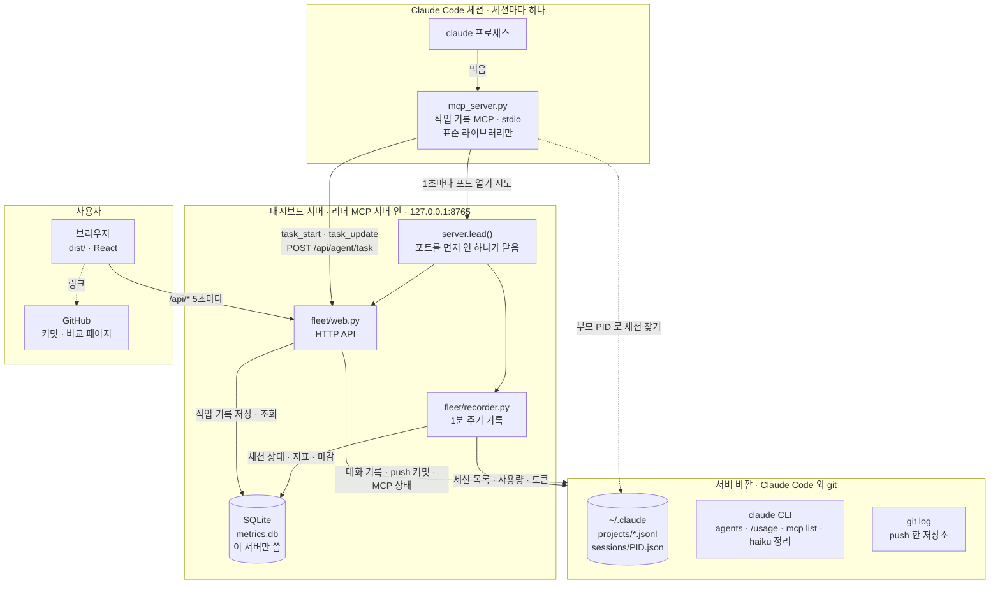

# hudson-fleet

내 PC에서 돌고 있는 Claude Code 세션들을 한 화면에서 보는 로컬 대시보드입니다.

살아 있는 세션의 상태, 서브에이전트, 작업 내용, 연결된 MCP 서버를 봅니다.

## 아키텍처

세션마다 MCP 서버가 하나씩 뜨고, 그중 **포트(8765)를 먼저 연 하나가 대시보드 서버를 맡습니다**(리더 선출). 나머지는 1초마다 다시 열어 보다가, 맡던 세션이 끝나 포트가 비면 하나가 이어받습니다. 그 사이 화면은 1~2초 갱신이 멈췄다 이어집니다. 플러그인을 업데이트한 뒤 세션에서 `/reload-plugins` 를 하거나 새 세션을 열면, 그 세션의 대기자가 10초마다 리더 버전을 보고 리더가 더 옛 버전이면 자리를 넘겨 달라고 합니다(`/api/handover`). 옛 리더는 포트와 1분 기록을 내려놓고, 열려 있던 화면은 새 버전으로 저절로 새로 고쳐집니다. 이 PC 에 더 새 버전이 설치돼 있으면 옛 버전 대기자는 포트가 3초 넘게 비어 있을 때만 맡습니다. 그래서 넘겨줄 때 새 버전이 먼저 자리를 잡고, 새 버전 세션이 없을 때만 옛 버전이 이어받습니다. 화면 헤더에는 지금 버전이 보이고, 더 새 버전이 설치돼 있으면 노란 표시와 [새 버전으로 바꾸기] 버튼이, 서버에 닿지 않으면 안내 띠가 뜹니다. 버튼을 누르면 리더가 설치된 새 버전 폴더의 `server.py` 를 세션과 따로(새 프로세스 그룹) 띄우고 자리를 넘깁니다(`/api/upgrade`). 이렇게 띄운 대시보드는 세션을 모두 닫아도 켜져 있고, 다음에 더 새 버전에 자리를 넘기면 끝납니다. 출력은 `server.log`(DB 옆)에 남습니다. 에이전트가 쓰는 작업 기록 도구는 세션 안에서 돌므로, 열린 세션마다 `/reload-plugins` 를 해야 새 버전이 됩니다. 작업 기록은 모든 MCP 서버가 대시보드 서버의 API 로 보내고, DB 는 대시보드 서버(리더) 하나만 씁니다.



## 설치 (Claude Code 플러그인)

```
/plugin install hudson-fleet --marketplace hava12/hudson-fleet
```

Claude Code 2.1.275 이전이면 두 단계로 설치합니다.

```
/plugin marketplace add hava12/hudson-fleet
/plugin install hudson-fleet@hudson-fleet
```

설치하면 **MCP 서버 `fleet`** 가 들어옵니다.

- 에이전트가 작업을 시작·완료·중단·반려할 때 직접 기록합니다 (아래 "작업 기록").
- 대시보드 서버도 함께 맡습니다. Claude Code 세션이 하나라도 떠 있으면 대시보드가 떠 있고, 세션을 모두 닫으면 꺼집니다 ([새 버전으로 바꾸기] 로 띄운 대시보드는 예외). 플러그인을 업데이트하면 새 세션이 리더가 될 때 새 코드로 뜹니다.

브라우저에서 http://127.0.0.1:8765 를 엽니다.

## 직접 실행

```sh
python3 server.py   # → http://127.0.0.1:8765 (세션 없이 혼자 띄울 때. 포트가 빌 때까지 10초 기다린다. 떠 있는 동안은 MCP 서버들이 리더가 되지 않는다)
```

- Python 3.9 이상. 표준 라이브러리만 씁니다 (대시보드 서버가 MCP 서버 안에서 시스템 `python3` 으로 돌기 때문).
- `claude` CLI가 PATH에 있어야 합니다.
- 화면은 `web/` 의 React(Vite) 앱이고, 서버는 빌드 결과 `dist/` 를 내보냅니다. 그래프 라이브러리도 함께 묶여 인터넷 연결 없이 뜹니다.

## 화면 개발 (web/)

```sh
cd web && npm install
npm run dev     # → http://localhost:5173 (API 는 떠 있는 8765 서버로 넘깁니다)
npm run build   # → ../dist
```

- `dist/` 는 커밋합니다. 플러그인 설치가 저장소를 그대로 받기 때문입니다.
- 플러그인 코드(`web/`·`fleet/`·`server.py`·`mcp_server.py`)가 바뀐 커밋이 main 에 들어오면 GitHub Actions(`.github/workflows/web.yml`)가 화면을 빌드해 `dist/` 를 커밋하고 플러그인 패치 버전을 1 올립니다. 그래서 버전을 손으로 올리지 않습니다. 버전이 올라야 `claude plugin update` 가 새 코드를 받으므로 서버만 고쳐도 올립니다.

| 파일 | 하는 일 |
|---|---|
| `src/main.jsx` | 상단 메뉴·사용량·알림, 페이지 전환(#home 등), 오른쪽 패널 틀, 함께 쓰는 상태(`App` 컨텍스트) |
| `src/Home.jsx` | 현황: 숫자 타일, 상태별 노드(그래프 + `SessionCard`), 남은 작업 |
| `src/Pages.jsx` | 세션 기록 · Push 기록 · 이슈·PR · 설정 |
| `src/Para.jsx` | PARA: 프로젝트·영역·자료·보관 네 칸 탭, PARA 설명 툴팁(`lib.jsx` 의 `Tip`) |
| `src/Mcp.jsx` | MCP 서버 그래프 |
| `src/SidePanel.jsx` | 오른쪽 패널: 프로젝트 · 세션 · MCP 서버 · 끝난 세션 |
| `src/TaskList.jsx` | 작업 목록 `TaskList` → `TaskRow` (key=작업 id, 펼침은 줄마다 `useState`). 상태가 섞이면 남은 일을 위로 묶고 완료·반려는 접는다. 남은 작업·세션 패널(기록할 작업·세션 기록) 3곳이 함께 씀 |
| `src/Graph.jsx` | cytoscape 띄우기(`useCy`)와 높이 맞추기 |
| `src/lib.jsx` | 상태·분류 표, 날짜·토큰 표시, `usePoll` |

## 작업 기록 (MCP)

| 도구 | 하는 일 |
|---|---|
| `task_start(text, tag, details?, project?)` | 작업을 시작하며 한 행을 만든다. id 를 돌려준다 (`project` 없이 적으면 진행 중인 프로젝트 목록 `projects` 와 바로잡는 방법 `hint` 도). `details` 는 할 일을 풀어 쓴 설명 최대 3줄, `project` 는 이 일이 속한 프로젝트 id |
| `task_update(id, status, note?, details?, project?)` | done 완료 · stopped 중단 · rejected 반려 · todo 남은 일. `note` 는 비고 한 줄 (완료·중단·반려 때 결과·이유), `details` 를 주면 설명 줄을 바꾼다. `project` 는 바로잡을 때만 (0 이면 뺀다) |
| `task_list()` | 이 세션의 작업 목록 (압축 뒤 이어받기) |
| `project_list()` | 끝나지 않은 프로젝트와 보관하지 않은 영역 `{projects, areas}`. 에이전트가 세션에서 처음 기록하기 전에 한 번 불러 `project` 를 고른다 |
| `project_archive(id)` | 프로젝트를 끝남(보관)으로, 그 프로젝트의 남은 일은 반려로 정리. 사용자가 대화에서 동의했을 때만 |
| `resource_save(title, summary, body, project?, area?)` | 자료 한 건. 사용자가 남기라고 했을 때와 프로젝트를 보관할 때 정리 한 장만. 요약은 100자 이내, 영역을 안 주면 프로젝트의 영역 |
| `resource_search(query?)` | 자료를 낱말로 찾는다 (낱말마다 제목·요약·본문 어딘가에 든 것, 최근 5건, 본문 1500자까지) |

MCP 서버는 기록을 대시보드 서버의 `POST /api/agent/task` 로 보내고, DB 에는 직접 쓰지 않습니다. 서버가 없으면(리더가 바뀌는 중) 5초까지 다시 시도하고, 그래도 없으면 오류를 돌려줍니다 (그 기록은 남지 않습니다). 서버가 옛 버전이면 껐다 켜라고 알려 줍니다.

어느 세션의 호출인지는 MCP 서버의 부모 프로세스(claude)로 찾습니다. `~/.claude/sessions/<pid>.json`의 `sessionId`를 읽으므로 에이전트가 세션 ID를 몰라도 됩니다.

에이전트가 기록하지 않은 세션만 haiku 가 대화에서 작업을 정리합니다. 웹에서 분류·태그를 바꾸거나 지울 수 있고, 사람이 고친 행은 다시 정리할 때도 남습니다.

**3-Step-Desc**: 작업 한 줄 아래에 설명을 1줄씩 최대 3개 붙입니다. 시작할 때는 계획을, 끝낼 때는 실제로 한 일을 적습니다. 지금은 2단계(작업 + 3줄)까지이고, 3단계가 필요해지면 설명 항목을 `{text, details}` 로 늘립니다 (`fleet/tasks.py` 의 `MAX_DETAILS`).

프로젝트·영역은 사용자만 만듭니다(PARA 페이지). 에이전트는 맞는 프로젝트가 없거나 애매하면 비워 두고, 없는 id 를 적으면 오류를 받습니다.

태그는 일의 종류입니다: 개발 · 디자인 · 기획 · 테스트 · 문서 · 디버그 · 데이터 · 운영 · 기타. 정의는 `fleet/tasks.py` 의 `TAGS` 한 곳에 있고, MCP 도구 설명과 haiku 프롬프트가 같은 표를 씁니다. 목록에 없는 값은 기타로 저장합니다.

## 기능

상단 메뉴는 **PARA · History(세션 기록 · Push 기록) · 이슈·PR · MCP 서버** 이고, 왼쪽 위 **Hudson Fleet** 로고를 누르면 현황으로 갑니다. History 는 눌러서 펼치는 드롭다운입니다. 오른쪽 위에는 구독 사용량(5시간·1주일), 버전, 설정(⚙)이 있습니다.

**현황** (5초마다 갱신, 끝났거나 실패한 세션과 대시보드 자신의 `claude -p` 호출(/usage·AI 요약)은 빼고 보여 줍니다. 다른 도구가 띄운 `claude -p` 세션은 보입니다)

- **상태별 노드**: 프로젝트 → 세션 → 실행 중인 서브에이전트. 세션 색은 상태(작업 중·입력 대기·쉬는 중)입니다. 영역 높이는 창 높이에 맞춰 고정이라 세션이 늘고 줄어도 아래 내용이 움직이지 않고, 대신 배율을 줄여 모두 보이게 합니다. 노드는 끌어 옮길 수 없고, 화면을 옮기거나 확대한 뒤 빈 곳을 두 번 누르면 전체 보기로 돌아옵니다. 옮기거나 확대한 동안에는 세션·서브에이전트가 늘고 줄어도 그 화면을 그대로 둡니다. 창 폭이 600px 이하(휴대폰)면 그래프는 배율이 너무 작아 읽을 수 없으므로, 대신 세션 카드 목록을 보입니다. 카드를 누르면 오른쪽(휴대폰은 아래) 패널이 열립니다.
- **숫자 타일**: 상태별 세션 수와 서브에이전트 수. 누르면 그 상태의 세션만 표와 그래프에 남깁니다.
- **남은 작업**: 모든 세션의 남은 일. 끝난 세션의 남은 일은 살아 있는 세션으로 옮길 수 있습니다. 프로젝트가 하나라도 있으면 줄마다 프로젝트 칸이 붙어, 에이전트가 비워 둔 일을 사람이 프로젝트에 붙입니다 (세션 패널의 작업 목록도 같음).
- **오른쪽 패널** (폭 조절 가능): 세션 제목, 실행 경로, 기록할 작업, 그 세션의 push (커밋마다 GitHub 링크). 기록할 작업은 10초마다 다시 받습니다. 보던 세션이 끝나면 [세션 기록에서 보기] 로 이어 봅니다.

**PARA** (티아고 포르테의 PARA: 일과 자료를 주제가 아니라 실행 가능성 순서로 네 칸에 나눈다. 제목 옆 물음표에 설명 툴팁이 있습니다). 탭은 Areas · Projects · Resources · Archives 순서입니다 — 프로젝트가 영역 아래에 달리므로 영역을 앞에 둡니다.

- **P · 프로젝트(Projects)**: 끝나는 때와 완료 조건이 있는 일. 사람이 만듭니다.
  - 이름과 완료 조건 한 줄이 있어야 만듭니다(완료 조건을 못 적으면 프로젝트가 아니라 영역). 상태(시작 전·진행 중·끝남)는 화면에서 바꾸고, 끝남으로 바꾸면 보관 칸으로 갑니다.
  - 끝남으로 바꾸면 그 프로젝트의 남은 일은 반려(비고: 프로젝트 끝남)로 정리됩니다. 남은 일이 있으면 확인 창이 뜨고, 남길 일은 먼저 작업 줄의 프로젝트 칸에서 다른 프로젝트로 옮깁니다.
  - Jira 와는 묶지 않습니다(이슈·PR 화면과 맡기기는 따로 동작). 에픽 단위로 관리하려면 이름에 에픽 키를 적습니다(예: `BVVB-1300 출석 알림`) — 에이전트가 이름을 보고 고릅니다.
  - 에이전트는 작업을 기록할 때 프로젝트 번호를 적습니다. 번호 없이 적으면 서버가 진행 중인 프로젝트 목록을 돌려주므로, 세션이 열린 뒤 만든 프로젝트도 에이전트가 알고 바로잡습니다.
  - 프로젝트 이름을 누르면 그 프로젝트로 기록된 작업이 세션 이름과 함께 펼쳐집니다.
- **A · 영역(Areas)**: 끝나지 않고 계속 지킬 책임. 이름과 유지할 상태 한 줄만 적고, 영역마다 진행 중인 프로젝트를 보여 줍니다. 더는 책임지지 않으면 [보관] 합니다.
- **R · 자료(Resources)**: 나중에 다시 쓸 참고. 에이전트가 MCP(`resource_save`)로 남깁니다 — 사용자가 "자료로 남겨"라고 할 때와, 프로젝트를 보관할 때 정리 한 장(무엇을 정했고 왜, 다음에 알아야 할 것)만. 에이전트가 스스로 수시로 남기지 않으므로 쌓여도 쓰레기통이 되지 않습니다. 화면에서는 낱말로 찾고 지웁니다.
- **A · 보관(Archives)**: 끝난 프로젝트와 보관한 영역. 따로 저장하지 않고 상태로 가릅니다(프로젝트 `status=done`, 영역 `archived_at`). 끝난 프로젝트는 상태를 바꿔, 보관한 영역은 [되살리기] 로 되돌립니다.
- 에이전트는 프로젝트의 완료 조건을 채운 것 같으면 보관할지와 정리 한 장을 남길지 한 번에 묻고(남은 일이 있으면 반려로 정리된다는 것도), 동의하면 보관합니다(`project_archive`).

**세션 기록**

- 대시보드 서버가 켜져 있는 동안 끝난 세션을 1분 안에 저장합니다. 종료 이유, 토큰, 기록할 작업을 남깁니다.
- **다시 열기**: 상세 패널의 [이어서 열기]는 같은 세션 ID 로(`claude --resume`), [복사해 열기]는 기록을 남긴 채 새 ID 로(`--fork-session`) 터미널 새 창에서 엽니다.
- **삭제**: 줄 끝 [삭제]는 그 기록을 세션 기록과 남은 일 목록에서 숨깁니다(soft delete — DB 의 `sessions.deleted_at` 만 적고 행·작업·push 는 남깁니다). `--resume` 으로 다시 살아나면 되돌아옵니다. 프로필 카드의 완료 건수는 그대로입니다.

**이슈·PR** (설정 ⚙ → 연결에서 GitHub·Jira 를 켜고 토큰을 넣었을 때)

- **Jira**: 나에게 할당되고 아직 끝나지 않은 이슈. 키를 누르면 Jira 로 갑니다.
- **맡기기**: 이슈 줄의 [맡기기] → 일할 폴더를 고르고 [새 에이전트에게 맡기기] 를 누르면, 그 폴더에서 백그라운드 에이전트(`claude --bg`)가 이슈 제목·본문을 받아 일을 시작합니다. 세션 이름은 `키 제목` 입니다.
  - 폴더는 지난 세션 기록(이름·제목)으로 미리 골라 둡니다: 같은 이슈를 했던 폴더 → 같은 프로젝트 키(`QA-`) 이슈를 가장 많이 한 폴더 → 최근 폴더. 맡길수록 세션 이름에 키가 남아 더 잘 맞습니다.
  - 에이전트에게는 커밋·push 를 하지 말라고 지시합니다. 권한을 물으면 현황에 "입력 대기"로 보이고, `claude attach <id>` 로 들어가 답합니다.
- **GitHub**: 열려 있는 내 PR 과 나에게 리뷰 요청된 PR.
- API 호출을 아끼려고 자동으로 갱신하지 않습니다. [새로 고침] 을 누릅니다.

**MCP 서버**

- `claude mcp list` 결과를 출처별(claude.ai 커넥터·플러그인·직접 설정) 그래프로 그립니다. 색은 연결 상태입니다.

**프로필 카드** (`HUDSON_FLEET_GIST` 를 정했을 때)

- 최근 7일·30일 완료한 작업을 태그별로 센 카드(`hudson-fleet.svg`)와 토큰 사용량 카드(`hudson-fleet-tokens.svg`, 오늘·7일·30일·1년 합계와 최근 12주 주간 막대)를 30분마다 Gist 에 덮어씁니다. GitHub 프로필 README 에 그 Gist 의 raw 주소를 이미지로 넣으면 됩니다.
- 공개되는 그림이라 작업 문장·경로는 넣지 않고 태그와 건수만 넣습니다. 미리보기: `/api/card.svg` · `/api/tokens.svg`

작업 정리(haiku)는 버튼을 누를 때와 세션이 끝날 때만 실행되며 Claude 구독 사용량을 씁니다.

## 설정 (환경 변수)

모두 환경 변수로 정합니다. `~/.claude/settings.json` 의 `"env"` 에 적으면 Claude Code 가 MCP 서버에 넘겨 주고, 그 안에서 뜨는 대시보드 서버도 같은 값을 받습니다. 바꾼 뒤에는 세션을 모두 닫았다 다시 열면 새 값으로 뜹니다. 지금 적용된 값은 웹의 **설정** 메뉴에서 봅니다.

**화면에서 바꾸기**: 웹의 설정(⚙)에서 요약 여부·요약 모델·보관 일수·터미널·Gist 두 값은 입력 칸으로 바꿉니다. DB 의 `settings` 표에 저장되고, 환경 변수보다 먼저이며 바로 적용됩니다(비우고 저장하면 원래대로). 포트·DB 경로는 서버가 켜질 때 정해지고 MCP 서버도 읽으므로 환경 변수로만 바꿉니다.

`~/.local/share/hudson-fleet/.env` 에 `KEY=VALUE` 줄로 적어도 됩니다. 플러그인을 업데이트해도 남는 곳입니다. 같은 이름이 환경 변수에 이미 있으면 환경 변수가 먼저입니다.

| 환경 변수 | 기본값 | 설명 |
|---|---|---|
| `HUDSON_FLEET_PORT` | `8765` | 대시보드 서버 포트 |
| `HUDSON_FLEET_DB` | `~/.local/share/hudson-fleet/metrics.db` | SQLite 파일 경로 |
| `HUDSON_FLEET_AUTO_SUMMARY` | `1` | 에이전트 기록이 없는 세션이 끝날 때 AI 로 작업 정리. `0` 이면 끔 |
| `HUDSON_FLEET_SUMMARY_MODEL` | `haiku` | 작업 정리에 쓰는 모델 |
| `HUDSON_FLEET_RETENTION_DAYS` | `0` | 1분 지표(samples) 보관 일수. `0` 이면 지우지 않음 |
| `HUDSON_FLEET_TERMINAL` | `Ghostty` | 끝난 세션을 다시 열 터미널 앱: `Ghostty` 또는 `Terminal` |
| `HUDSON_FLEET_GIST` | (비움) | 프로필 카드를 30분마다 덮어쓸 Gist id. 비우면 끔 |
| `HUDSON_FLEET_GIST_USER` | (비움) | Gist 를 올릴 `gh` 계정. 비우면 `gh` 의 현재 계정 |
| `HUDSON_FLEET_GITHUB_ON` · `HUDSON_FLEET_JIRA_ON` | `0` | 연결 사용 여부. 설정(⚙) → **연결** 칸의 '사용' 확인란. 켜야 입력 칸이 보이고 쓰입니다. 꺼도 넣어 둔 값은 남습니다 |
| `HUDSON_FLEET_GITHUB_TOKEN` | (비움) | GitHub 개인 액세스 토큰. 설정(⚙) → **연결** 칸에서 넣습니다 |
| `HUDSON_FLEET_JIRA_SITE` · `_EMAIL` · `_TOKEN` | (비움) | Jira 사이트 주소(예: `aptplay.atlassian.net`), 로그인 이메일, API 토큰. 설정(⚙) → **연결** 칸에서 넣습니다 |
| `HUDSON_FLEET_URL` | `http://127.0.0.1:<포트>` | MCP 서버가 작업 기록을 보낼 대시보드 서버 주소. 다른 PC 의 서버를 쓸 때만 바꿉니다 (`mcp_server.py` 만 읽음) |

## 데이터

SQLite 파일 하나에 저장합니다 (`HUDSON_FLEET_DB`).

| 표 | 내용 |
|---|---|
| `sessions` | 세션 1행. 상태(work·wait·idle·closed)와 그 상태가 된 시각, 종료 이유, 토큰 |
| `session_tasks` | 세션의 기록할 작업 N행. 표시 순서(`sort`), 분류(todo·done·stopped·rejected), 태그(`tag`, 일의 종류), 설명 줄(`details`, JSON 배열 최대 3줄), 비고(`note`), 기록 주체(agent·haiku·human), 프로젝트(`project_id`) |
| `areas` | 영역: 이름(겹치지 않음), 유지할 상태 한 줄, 보관한 시각(`archived_at`) |
| `projects` | 프로젝트: 이름, 영역, 완료 조건, 상태(pending·active·done — done 이 보관), 시작일·끝난 날 (0.5.27 까지 만든 DB 에는 지운 Jira 에픽 연결의 칸이 쓰이지 않은 채 남아 있음) |
| `resources` | 자료: 제목, 한 줄 요약(100자), 본문, 프로젝트·영역, 남긴 세션, 만든 시각 |
| `samples` | 1분마다 상태별 세션 수, 서브에이전트 수, 5시간·1주일 사용률 |
| `daily` | 날짜별 토큰 합계 (캐시 읽기 제외) |

## 의존성

**표준 라이브러리만** 씁니다. MCP 서버는 Claude Code 가 시스템 `python3` 으로 띄우고, 대시보드 서버도 그 안에서 돌기 때문입니다. 시스템 Python(Homebrew 등)은 `pip install` 을 막으므로(`externally-managed-environment`) 외부 패키지를 넣으면 대시보드가 뜨지 않습니다. 확인 명령 (site-packages 없이 import):

```sh
python3 -S -c "import sys; sys.path.insert(0, '.'); import mcp_server, server"
```

## 코드 구조

`server.py` 는 실행 진입점이고, 기능은 `fleet/` 에 나뉘어 있습니다. 위층은 아래층만 가져다 씁니다 (거꾸로 가져오면 순환 import).

| 파일 | 하는 일 |
|---|---|
| `fleet/config.py` | 환경 변수 설정, 경로, `claude` CLI 호출 |
| `fleet/db.py` | SQLite 표 만들기, 제목·지표 조회 |
| `fleet/transcripts.py` | 대화 기록(`.jsonl`) 읽기: 개요, 서브에이전트, 토큰 |
| `fleet/agents.py` | 살아 있는 세션: `claude agents`, 프로세스, 그래프, 패널 개요, MCP 상태, 다시 열기 |
| `fleet/tasks.py` | 작업 기록(추가·수정·조회)과 haiku 정리, `TAGS` |
| `fleet/para.py` | PARA: 영역·프로젝트 만들기·고치기·보관(남은 일 정리), 자료 저장·찾기 |
| `fleet/usage.py` | `/usage` 사용률, 세션별 5시간 몫, 날짜별 토큰 |
| `fleet/links.py` | GitHub·Jira REST 연결 (토큰 인증은 이 파일의 `github()`·`jira()` 두 곳만, 표준 라이브러리만) |
| `fleet/pushes.py` | 세션에서 실행한 git push 기록 (Claude 의 Bash 와 사용자의 `!` 명령) |
| `fleet/card.py` | 프로필 카드 SVG 그리기와 Gist 덮어쓰기 |
| `fleet/recorder.py` | 1분 주기 기록 스레드: 지표, 세션 상태, 끝난 세션 마감, 30분마다 프로필 카드 |
| `fleet/web.py` | HTTP API 와 화면 (`dist/`) |
| `mcp_server.py` | 작업 기록 MCP 서버 (stdio). 대시보드 서버의 `/api/agent/task` 로 보냅니다 (DB 는 서버만 씀) |

```
4  recorder · web
3  card
2  agents · tasks · usage · pushes · para
1  db · transcripts
0  config
```

## API

| 경로 | 내용 |
|---|---|
| `GET /api/sessions?status=closed\|work\|wait\|idle&limit=50` | 세션과 작업 목록 (지운 기록은 빠짐) |
| `POST /api/session/delete` | 끝난 세션 기록 지우기 `{sid}` (soft delete). 끝난 세션이 아니거나 이미 지웠으면 `{error}` |
| `GET /api/pushes?limit=200&sid=` | 세션에서 실행한 git push — Claude 의 Bash 와 사용자의 `!` 명령, 세션 밖 터미널은 빠짐 (시각·레포·브랜치·커밋 메시지·세션). `sid` 를 주면 그 세션 것만. 대화 기록이 지워져도 DB 에 남습니다 |
| `GET /api/metrics?hours=24` | 1분 단위 지표 |
| `GET /api/daily` | 날짜별 토큰 (최근 1년) |
| `GET /api/usage` | 5시간·1주일 사용률 (`/usage` 결과) |
| `GET /api/mcp` | MCP 서버 연결 상태 |
| `GET /api/version` | 화면을 띄운 리더의 버전과 설치된 플러그인 버전 |
| `POST /api/handover` | 더 새 버전 대기자가 리더 자리를 넘겨 달라고 함 `{version}`. Origin 이 없는 요청만, 더 새 버전일 때만 물러남 |
| `POST /api/upgrade` | [새 버전으로 바꾸기]: 설치된 새 버전의 `server.py` 를 세션과 따로 띄우고 자리를 넘김 → `{ok, version}`. 더 새 버전이 설치돼 있지 않으면 `{error}` |
| `GET /api/assign?key=` · `POST /api/assign` | 맡기기: 폴더 추천 `{cwd, why, recent}` · `{key, cwd}` 로 그 폴더에 이슈를 맡긴 백그라운드 에이전트를 띄움 (`claude --bg -n "키 제목"`) |
| `GET /api/para` | PARA 페이지: 영역·프로젝트(프로젝트마다 기록된 작업, 세션 이름 포함)·자료 전부 `{areas, projects, resources}` |
| `GET /api/projects` | 작업 줄의 프로젝트 칸: 프로젝트 전부 `[{id, name, status}]` |
| `POST /api/resource` | 자료 지우기 `{id}` (자료는 에이전트가 MCP 로만 남긴다) |
| `POST /api/area` · `POST /api/project` | 영역 `{id?, name, keep, archive?, delete?}` · 프로젝트 `{id?, name, done_when, area_id, status, delete?}` 만들기·고치기·지우기. 잘못되면 `{error}` |
| `GET /api/jira` · `GET /api/github` | 이슈·PR 페이지: 나에게 할당된 끝나지 않은 Jira 이슈 `{items}` · 열린 내 PR 과 리뷰 요청 PR `{mine, review}`. 꺼져 있거나 토큰이 없으면 `{error}` |
| `POST /api/connect` | 연결 확인 `{service: github·jira}` → 저장된 토큰으로 내 계정 이름 `{ok, who}` 또는 `{error}` |
| `GET /api/config` · `POST /api/config` | 지금 적용된 설정 값(`src`: 화면·환경 변수·기본값, `edit`: 화면에서 바꿀 수 있는지, `secret`: 토큰이라 끝 4글자만) · 바꾸기 `{name, value}` |
| `POST /api/agent/task` | MCP 서버의 작업 기록 `{op: start·update·list·projects·project_archive·resource_save·resource_search, sid, …}`. Origin 이 없는 요청만 |

## 보안

- 서버는 `127.0.0.1`에서만 열립니다.
- 요청의 Host 가 `127.0.0.1`·`localhost` 가 아니면 거부합니다. 악성 사이트가 자기 도메인을 127.0.0.1 로 바꿔치는 수법(DNS 리바인딩)으로 화면과 API 를 읽지 못하게 합니다.
- 다른 웹사이트가 보낸 API 요청(`Sec-Fetch-Site` 가 cross-site·same-site)은 GET 도 거부합니다. 이미지 태그 하나로 명령(`claude mcp list` 등)을 실행시키지 못하게 합니다.
- 다른 출처(Origin)에서 오는 POST 요청은 거부합니다. `http://127.0.0.1:8765` 와 `http://localhost:8765` 는 받습니다.
- 세션 ID 자리에는 세션 ID 형식만 받습니다. `../` 로 Claude 기록 폴더 밖 파일을 읽지 못하게 합니다.
- DB 파일은 나만 읽고 쓸 수 있게(600), DB 폴더는 나만 열 수 있게(700) 권한을 바꿉니다. 토큰과 프롬프트가 들어 있기 때문입니다.
- `POST /api/agent/task` 만 Origin 이 **없는** 요청을 받습니다. 브라우저는 POST 에 Origin 을 꼭 붙이므로 다른 웹사이트는 이 길로 들어올 수 없습니다. 세션 ID 형식도 검사합니다.
- 종료는 `claude agents` 목록에 있는 세션만 할 수 있습니다.

## 한계

- 종료된 대화형 세션은 서버가 켜져 있을 때 끝난 것만 기록됩니다.
- 종료 이유 `exited`는 직접 종료·창 닫기·크래시를 구분하지 못합니다.
- 서브에이전트 실행 여부(`meta.json`의 `finished`)는 공식 형식이 아니라 바뀔 수 있습니다.
- MCP 목록은 홈 폴더 기준입니다. 프로젝트에만 설정한 서버는 빠질 수 있습니다.
